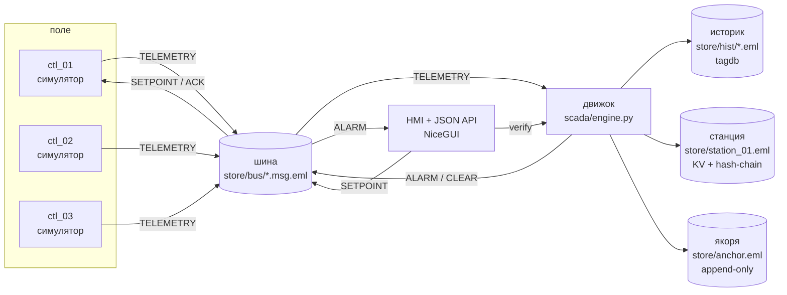
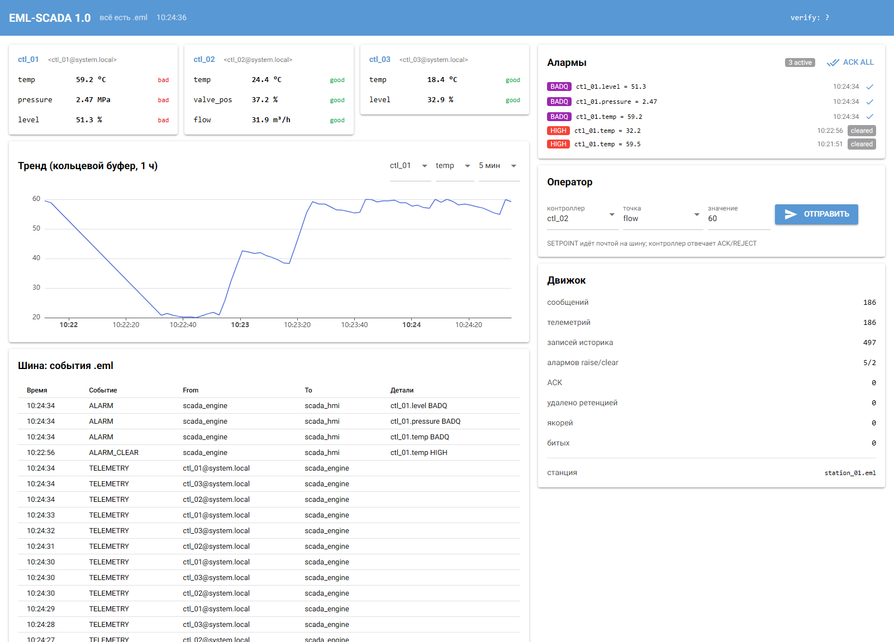

# EML-SCADA

**SCADA-стек, в котором всё — `.eml`.**

[](CHANGELOG.md)
[](pyproject.toml)
[](tests)
[](https://github.com/kostyk348/mime-os)
[](https://github.com/kostyk348/eml-scada/releases)
[](https://github.com/kostyk348/eml-scada/commits/master)

Историк — записи tagdb, станция — контейнер с KV-таблицами, сообщения
контроллеров — MIME-письма в спуле, аларм-лог — дельты с hash-chain.
Никакой бинарной БД: любой файл читается глазами и проверяется независимо.
Один адрес — один потребитель: движок читает только `scada_engine`, HMI —
только `scada_hmi`, контроллер — только свой ящик.





*Дашборд: точки контроллеров, тренд из кольцевого буфера, алармы, трафик шины
и счётчики движка.*

## Быстрый старт

```bash
pip install -e .            # или: pip install nicegui

# нужен собранный emlbox из mime-os
export EMLBOX=/path/to/mime-os/target/release/emlbox     # Windows: $env:EMLBOX="C:\...\emlbox.exe"

python -m scada.run headless --seconds 10               # прогон без GUI + verify
python -m scada.run run --port 8080                     # HMI: http://127.0.0.1:8080
python -m scada.run verify                               # проверка целостности стора
python -m scada.run demo                                 # tamper-evident демо

python -m scada.run --headless --seconds 8               # старый синтаксис v0.1 работает
```

Тесты: `python -m pytest` (46 тестов). Без собранного `emlbox` тесты с маркером
`integration` пропускаются; `python -m pytest -m "not integration"` — чистая
логика (алармы, конфиг, ретенция).

## Что нового в 1.0

| Было (v0.1) | Стало (1.0) |
|---|---|
| состояние станции: `kv set` на **каждую точку каждого тика** (8 дельт/с) | один KV-дельт на контроллера раз в `station.state_persist_s` (15 с) |
| спул шины рос без ограничений (`.done` копились) | ретенция: TTL для `.done`/`.tmp` + лимит записей историка |
| публикация сообщения = `write` прямо в спул (гонка с читателем) | `tmp` + `os.replace`: читатель не видит половину сообщения |
| движок читал **всю** почту, включая чужую | фильтр по адресу: только своя почта, тело чужой не читается |
| график HMI = запрос в tagdb на каждый refresh | живой график из кольцевого буфера в памяти, tagdb — только глубокая история |
| `verify` = один вызов `emlbox verify` | независимый Python-парсер + журнал якорей (`store/anchor.eml`) |
| конфиг захардкожен | `config.json` с валидацией (`ConfigError` вместо тихо неверного поведения) |
| нет API | JSON-API: `/healthz`, `/api/state`, `/api/alarms`, `/api/series`, `/api/history`, `/api/verify`, `POST /api/ack`, `POST /api/setpoint` |
| нет тестов | 46 тестов (unit + integration), pytest-маркеры |
| ротация станции отсутствовала | ротация по числу дельт в `store/archive/` + якорь на финальное имя |

## Замеры (Windows 10, Python 3.14, emlbox из mime-os, 8 точек, 10 с прогона)

| Метрика | v0.1 | 1.0 |
|---|---|---|
| дельт в станции | 58 (≈5.3/с) | 4 (≈0.36/с; в установившемся режиме 3 контроллера / 15 с = **0.2/с**) |
| размер станции после прогона | 26 486 B | 3 016 B |
| записей историка | 55 (≈5.0/с при темпе генератора 8/с — не успевал) | 91 (≈7.9/с — полный темп, потерь нет) |
| `.done` в спуле | 21, не чистятся | 36, чистятся по `bus.done_ttl_s` |

Экстраполяция по дельтам: 0.2/с → ~17 300 дельт/сутки; при лимите ротации
20 000 это ~1 ротация в сутки. У v0.1 при 5.3/с — ~458 000 дельт/сутки
(ротация каждый час, tail index в контейнере растёт квадратично).

Стоимость одного вызова CLI (на ней стоит всё): `emlbox kv get` — **41 мс**,
`tagdb query` на 34 записи — **159 мс**. Именно поэтому запись состояния
пачкой, а не по точке: v0.1 тратил 8 × 41 мс в секунду только на состояние.

Проверка целостности на реальном контейнере (843 дельты, 374 KB):
`emlbox verify` — 100 мс, независимый `deep_verify` — 58 мс.

## Данные на диске

| Слой | Где | Формат |
|---|---|---|
| Историк | `store/hist/*.eml` | запись tagdb: `X-Tag`=точка, `X-Device-ID`, `X-Timestamp`, тело `{value, quality}` |
| Станция | `store/station_01.eml` | контейнер, KV-таблицы `config`, `state`, `alarms` |
| Архив | `store/archive/station_01_<ts>.eml` | тот же контейнер после ротации |
| Якоря | `store/anchor.eml` | append-only KV-таблица `chain`: seq/prev/sha256/base/tail |
| Шина | `store/bus/*.msg.eml` → `*.done` | `From/To/X-Event` + JSON-тело |

Протокол шины: `TELEMETRY` (контроллер → движок), `SETPOINT` / `SETPOINT_ACK` /
`SETPOINT_REJECT` (HMI ↔ контроллер), `ALARM` / `ALARM_CLEAR` / `ALARM_ACK`
(движок ↔ HMI).

## JSON-API

| Метод | Что делает |
|---|---|
| `GET /healthz` | живость, uptime, активные алармы, имя станции |
| `GET /api/state` | снимок: точки, алармы, трафик, статистика |
| `GET /api/alarms?limit=200` | алармы + статистика (active/unacked/high/low/badq) |
| `GET /api/series?device=ctl_01&point=temp&minutes=5` | живой график (память) |
| `GET /api/history?point=temp&device=ctl_01&minutes=60` | история из tagdb |
| `GET /api/verify?deep=true` | проверка всех контейнеров + якорей (+ новый якорь) |
| `POST /api/ack` | `{"id": "..."}` или `{"all": true}` |
| `POST /api/setpoint` | `{"cid": "ctl_02", "point": "flow", "value": 55}` |

`/api/setpoint` валидирует границы точки в движке и в контроллере: 400 на
`value` вне `[lo, hi]` или на неизвестную точку.

## Целостность

`emlbox verify` пересчитывает base-хэш и цепочку дельт, но **не хэширует tail
index и трейлер** (ограничение mime-os, п.1). Значит последнюю дельту можно
переписать, поправить её хэш в tail index и `X-Tail-Hash` — и `verify` скажет OK.

`scada/integrity.py` добавляет два независимых уровня (своя реализация формата):

1. **Структура**: границы секций, непрерывность дельт, инварианты трейлера
   (`tail_index_off + tail_index_len + 512 == size`), `X-Delta-Seq`,
   `X-Entity-ID`, отсутствие хвоста после трейлера.
2. **Якоря**: в `store/anchor.eml` после проверки/ротации пишется `sha256`
   файла + base/tail-хэши, записи связаны `prev`/`self` (append-only цепочка).
   Рост станции допустим только как продолжение заякоренной цепочки;
   перезапись заякоренной дельты или base — ловится.

```
$ python -m scada.run demo
[1] честная станция: deep verify = OK
[2] порча тела дельты: emlbox=BROKEN, deep=BROKEN
[3] подмена последней дельты + пересчёт хэшей: emlbox=OK, deep=BROKEN
>>> TAMPER-EVIDENT: OK
```

`anchors.export_head()` отдаёт голову цепочки (seq/self/sha256) — её можно
унести в коммит, письмо или бумажный лог.

## Честные границы

1. **Якорь лежит на той же машине.** Он защищает от правки станции без доступа
   к журналу якорей, но не от того, кто перепишет оба файла согласованно. Для
   этого и нужен офсайт-`export_head()`; автоматической отправки нет.
2. **Шина — каталог на одном хосте.** Нет сети, аутентификации, шифрования и
   fan-out (один адрес — один потребитель). Это спул, а не брокер.
3. **Контроллеры — симуляторы.** Modbus/OPC UA/реальных PLC нет; протокол шины
   свой.
4. **Потолок по throughput — CLI.** Каждый вызов `emlbox` ≈ 41 мс на холостой
   машине (замер `kv get`), т.е. ~24 вызова/с на ядро; цикл движка
   синхронный, поэтому при внешней нагрузке (например, параллельная сборка
   Rust) спул шины отстаёт: на загруженной машине замерено отставание 6 с и
   метка `stale` на всех точках. Для сотен точек нужен batch-API в mime-os;
   текущая конфигурация (8 точек, 1 Гц) укладывается с запасом на холостой
   машине.
5. **У HMI нет аутентификации.** По умолчанию слушает `127.0.0.1`; наружу не
   выставлять без reverse-proxy.
6. **Ретенция историка — по mtime и количеству файлов**, без индекса. На
   миллионах записей один проход `scandir` станет заметным (сейчас
   `prune_every_s=60`).
7. **Лицензия.** В `pyproject.toml` указано `Apache-2.0`, но файла `LICENSE` в
   репозитории нет — нужно решение владельца (добавить Apache-2.0 или сменить).

## Конфигурация

`<store>/config.json` создаётся при первом запуске; приоритет:
`--config` > `<store>/config.json` > дефолты (`scada/config.py::DEFAULTS`).
Опечатка в имени или типе значения → `ConfigError` на старте.

| Ключ | Смысл |
|---|---|
| `engine.tick_s` / `engine.stale_after_s` | период цикла движка / когда точка считается устаревшей |
| `station.state_persist_s` | как часто снимок состояния пишется в контейнер |
| `station.rotate_after_deltas` | порог ротации станции в архив (≥100) |
| `historian.keep_hours` / `max_records` / `prune_every_s` | ретенция историка |
| `bus.done_ttl_s` / `tmp_ttl_s` | TTL для `.done` и осиротевших `.tmp` в спуле |
| `integrity.anchor_every_s` / `anchor_on_verify` | период якорей / ставить ли якорь при `verify` |
| `alarms.realarm_s` / `max_items` | напоминание по активному аларму / размер истории |
| `sim.*` | симулятор: тик, дефекты (всплеск + bad quality) |
| `hmi.host` / `port` / `refresh_s` | адрес HMI |
| `thresholds.<point>` | `low`/`high`/`deadband` (мёртвая зона против дребезга) |

## Структура кода

```
scada/
  config.py       конфиг + валидация (ConfigError)
  emlbox.py       обёртка CLI + MIME-шина (атомарная публикация)
  controllers.py  симуляторы контроллеров, SETPOINT/ACK/REJECT
  engine.py       движок: телеметрия, историк, состояние, алармы, ротация
  alarms.py       raise/clear/rearm/ack (чистая логика без I/O)
  integrity.py    независимый парсер контейнера + журнал якорей
  retention.py    ретенция историка и спула
  api.py          JSON-API
  hmi.py          NiceGUI-дашборд
  run.py          CLI: run / headless / verify / demo
tests/            46 тестов: unit (алармы, конфиг, ретенция) + integration (emlbox)
```

## Требования

Python 3.11+, `nicegui>=2.0`, собранный `emlbox` из
[mime-os](https://github.com/kostyk348/mime-os) (`cargo build --release`).
Путь к бинарю: переменная `EMLBOX`, иначе `target/release/emlbox.exe` рядом,
иначе `PATH`.

CI (`.github/workflows/ci.yml`): job `unit` — `pytest -m "not integration"`;
job `integration` — клонирует mime-os, собирает `emlbox`, гоняет весь набор.
mime-os пинуется на ревизию `22f1315` — на ней тесты зелёные; `master`
mime-os на момент релиза не собирается на Linux (`E0716`), поэтому
«просто master» в CI даёт красный job.
